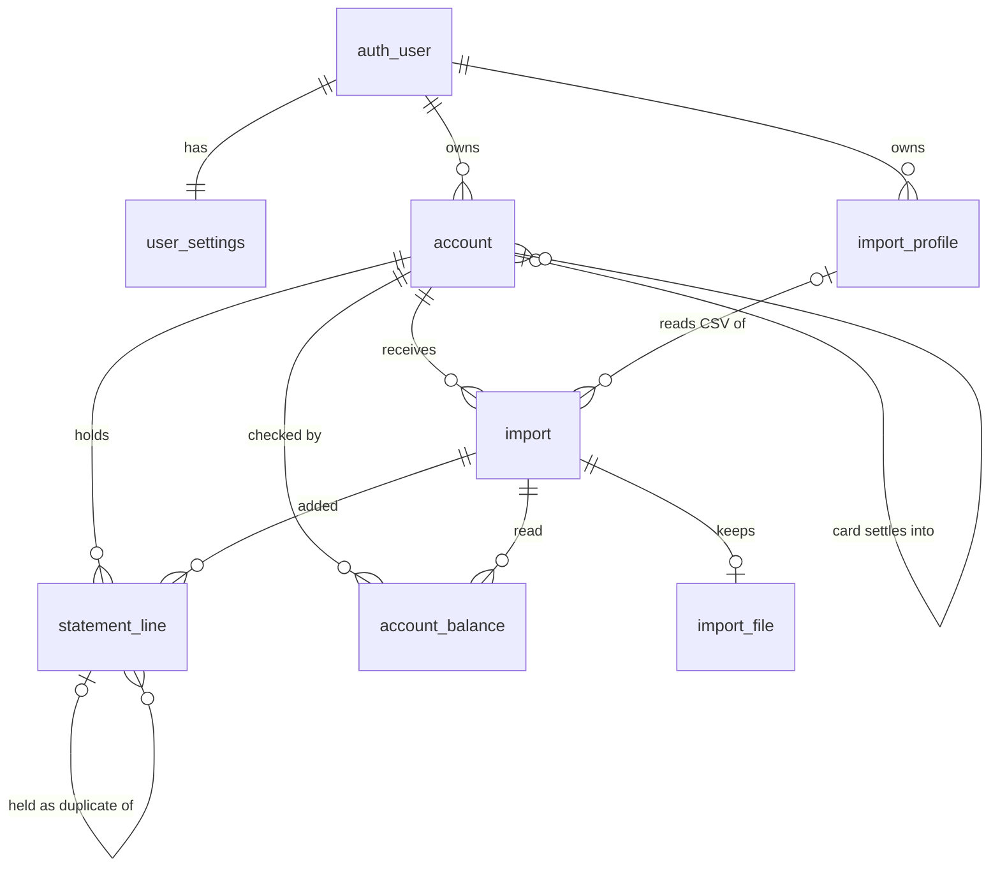
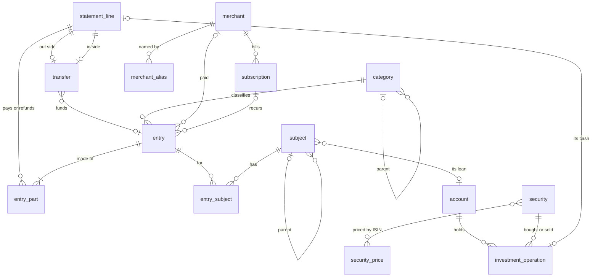

# Gousset: data model

The tables of v0.2 (users, accounts, statement lines, imports, import profiles), how money, currencies, dates and ownership are stored, how each user's rows are kept apart, how an import avoids duplicates, and what the later milestones add on top. Written for issue #12 on 2026-11-22; `packages/db` (issue #13 and after) writes the schema from it. The words are those of [`vision.md`](vision.md#words). Every example here is invented.

What a table holds and how it relates is decided here; column types and indexes beyond those named are left to the schema. A milestone may add tables and nullable columns; it should not have to change what v0.2 wrote.

## Conventions

- **Postgres 18, written with Drizzle.** Tables and columns in `snake_case`, singular names (`account`, not `accounts`), as the existing `installation_settings` does.
- **Gousset's own ids are `uuid`, filled by Postgres 18's `uuidv7()`.** They are ordered by creation, which keeps indexes compact; they reveal neither how many rows other users have nor in which order they were made; and an export restored elsewhere keeps them. The user's id stays better-auth's `text`.
- **Closed sets are Postgres enums** (`pgEnum`): the database refuses an unknown value and Drizzle gives the TypeScript union. A new value is one `ALTER TYPE … ADD VALUE`.
- **Instants are `timestamptz`** (`created_at`, `updated_at`, `finished_at`). better-auth's tables keep the `timestamp` it generates.
- **Nothing is soft-deleted.** An account is closed, a category archived (v0.3): both keep their history. What is deleted is gone, and what refers to it goes with it. The one row kept for its memory is a discarded line ([Statement lines](#statement-lines)), so that it does not come back.
- **An optional reference is cleared with its own column**: since foreign keys share `user_id` ([Ownership and isolation](#ownership-and-isolation)), they use `on delete set null (<column>)` (Postgres 15 and later), which never touches `user_id`.
- **No personal data in names, logs or telemetry**: labels, amounts, IBANs and file names live in their rows and nowhere else ([`architecture.md`](architecture.md#telemetry)).

## Money

- **An amount is a `bigint` of minor units** (cents for the euro) in the currency of its account: `amount_minor`, `opening_balance_minor`. Integers are exact, they add up in SQL without rounding, and the made-up data (`packages/fixture`) already counts that way. Drizzle reads them as JavaScript numbers (`mode: "number"`), exact up to 2⁵³ minor units, far beyond any personal amount; a `sum()` comes back from Postgres as `numeric` and is cast to `bigint` in the query.
- **Signs follow the account**: negative is money leaving the account, positive money coming in. A loan's balance is negative (what is owed), and a repayment is a positive line on it. Gousset never stores "debit" and "credit" columns: a reader that meets them turns them into a sign.
- **One currency per account** ([`vision.md`](vision.md#v1)): `account.currency`, an ISO 4217 code. A line has no currency of its own. Its number of minor units (2 for the euro, 0 for the yen, 3 for the Bahraini dinar) comes from ISO 4217 in code, never from a column.
- **A payment made in another currency** keeps what the bank says it was: `original_amount_minor` and `original_currency` on the line, for display only. Only `amount_minor`, in the account's currency, counts.
- **Quantities and unit prices of securities (v0.6) are `numeric`**: a fund's share can be 0.0347 of a unit and its price 112.4519 €. They are exact decimals, read as strings and computed with a decimal library; the value they give is rounded to minor units only when shown or summed with money.
- **Totals across currencies are not converted in v0.2**: the accounts page totals each currency apart. How rates come in is an open question ([Open questions](#open-questions)).

## Dates

- **A statement's days are `date`, with no time and no time zone**: `booked_on` (the day the bank booked the line), `value_on` (its value date, when the file gives one). A bank's day is a day of its calendar, not an instant: stored as a timestamp in UTC, a line booked on 1 November would move to 31 October for anyone west of the bank. Months are made of these days directly.
- **The booking date places a line in its month and in the account's balance.** The value date is kept for display and for matching transfers; nothing is computed from it in v0.2.
- **The day an expense happened is the expense's own** (v0.3, `entry.happened_on`): it starts as its first payment's booking date and can be moved (a card payment of 31 October booked on 3 November). "Where the money goes" reads that date; an account's balance reads the lines'. A line stays as the bank wrote it.
- **A balance is the balance at the end of its day** (`account_balance.day`). A statement's opening balance for 1 October is stored as the balance at the end of 30 September, so that every balance compares with the same sum of lines.
- **Each user has a time zone** (`user_settings.time_zone`, IANA, such as `Europe/Paris`): it says which day "today" is (the current month, what expires today) and how instants are shown. It never changes a stored date.

## Ownership and isolation

**Every row of a user's data carries `user_id`**, referencing `auth_user.id` with `on delete cascade`: deleting a user deletes their data, and an export (#22) is one query per table, `where user_id = …`. Child tables carry it too (a line has its own `user_id`, not only its account's), so that every rule of isolation reads one column, with no join.

**A row can only point to a row of the same user.** Each parent table has a unique key on `(user_id, id)`, and children reference it with composite foreign keys: `statement_line (user_id, account_id) → account (user_id, id)`. The database itself refuses a line of one user on another user's account, whatever the code does.

**Row-level security keeps each user's rows apart** (#13), set per transaction by the server:

1. A migration creates the role `gousset_user` (`NOLOGIN`, not a superuser, without `BYPASSRLS`) when it does not exist yet (roles are shared by every database of the server, and end-to-end tests clone one per worker), grants it `select`, `insert`, `update` and `delete` on the users' tables, and grants it to the role the app logs in with.
2. Each table holding a user's rows has row-level security enabled and one policy for every command: `using (user_id = current_setting('gousset.user_id', true)) with check (user_id = current_setting('gousset.user_id', true))`.
3. Every server function, MCP tool and job that works for a user opens its transaction through one Effect service, which starts with `set local role gousset_user` and `select set_config('gousset.user_id', $1, true)`. Both end with the transaction, so a pooled connection never carries a user into the next one.
4. A transaction that switched role but set no user sees an empty setting, and the policies return no row: it fails closed.

The role switch is what makes the policies bite. The app logs in as the Postgres image's user, a superuser, which row-level security never restricts; inside a user's transaction it acts as `gousset_user`, which it does restrict. Outside one, the app keeps its own role for what is not a user's data: migrations, better-auth, pg-boss's own tables, installation-wide jobs (prices, v0.6). That role is not restricted, so **a user's tables are reached only through the service**: `packages/db` exports the tables to the service and to migrations, and code that queries them elsewhere is a bug that #13's tests are written to catch. The administrator is a user like the others for data: they never see another user's rows.

A job that works for a user (an import, a rule applied to the past) carries the user's id in its payload and opens the same transaction. #13's tests try every isolation rule through the server functions: a user never reads, changes or deletes another user's row.

## Users

better-auth's `auth_user` is the user; its tables keep their `auth_` prefix (its `account` would collide with bank accounts). What Gousset adds lives in its own table, since `auth.ts` is regenerated by better-auth's tool.

**`user_settings`**, one row per user, made at sign-up:

| Column | What |
|---|---|
| `user_id` | the key, and the owner |
| `main_currency` | ISO 4217; the default currency of a new account, and the currency benchmarks are written in (v0.3) |
| `time_zone` | IANA name, taken from the browser at sign-up; which day is today when the server renders a page |

The interface's language stays the browser's, as in v0.1: no column for it.

## Accounts

**`account`**: one per account the user follows, of every kind.

| Column | What |
|---|---|
| `id`, `user_id` | |
| `name` | as the user calls it: "Current account", "MealCard" |
| `kind` | `current`, `savings`, `card`, `investment`, `loan`, `benefit` |
| `envelope` | the tax envelope, or null: `pea`, `life_insurance`, `livret_a`, `other` |
| `institution` | the bank, broker or issuer, as text: "Northbank" |
| `currency` | ISO 4217, fixed once the account has a line |
| `mode` | `lines` (every line imported or entered) or `balance` (a balance noted each month) |
| `opening_balance_minor` | the balance before the account's first line |
| `opened_on` | the day the account was opened at the bank, when known; envelopes count from it |
| `closed_on` | null while open; a closed account keeps its lines and leaves the totals |
| `iban`, `number` | how a statement names the account (CAMT and MT940 give an IBAN, OFX an account number), to recognise it at import; unique per user when set |
| `settles_into_account_id` | a deferred-debit card only: the current account it is debited from each month |
| `credit_order` | a benefit account only: in which order its credits are used, `oldest_first` (by the day credited, the default) or `expiring_first` (by expiry date) |
| `created_at`, `updated_at` | |

**Kind and envelope are two columns.** The kind says how an account behaves; the envelope says which tax rules it is under. A PEA and a securities account both hold positions; a Livret A is a savings account; a life insurance contract holds funds. So "securities account", "PEA" and "life insurance", which #15 offers as choices, are `investment` with no envelope, `pea` and `life_insurance`; a Livret A is `savings` with `livret_a`. The logic of positions is written once, and an envelope's rules apply to whichever account carries it. The envelope's figures (a contribution cap, a key date) come in v0.6, as columns of the account ([v0.6](#v06-investments)): the vision keeps them per account.

**The accounts page's groups follow the kind**, in code, not in a column: available (`current`, `savings`, `card`), restricted (`benefit`), invested (`investment`), owed (`loan`).

- **A card account is a deferred-debit card**: its purchases are lines of its own, and once a month the current account pays its balance, which v0.3 pairs as a transfer (#26); a card statement that does not show that payment gets its side as a line made by the app ([v0.3](#v03-classify)). A card debited at once is no account: its payments are lines of the current account.
- **A benefit account** (meal vouchers, works council subsidies, gift cards) is money with restricted use. Its credits are positive lines, each with its expiry date (`statement_line.expires_on`). What is left on each credit, and what expires when, is computed on read in the account's `credit_order` (#16), never stored: every outgoing line (a payment, a transfer out) uses up the credits in that order. An issuer whose order is neither gets a value of its own when one is met. Expiry dates never move money by themselves: what expires unused leaves the balance when a line says so, from the issuer's statement or entered by hand.
- **A loan account** holds what is owed: its balance is negative, noted each month (balance mode) or made of its repayments. A subject with a value points to its loan (v0.5).

**`account_balance`**: a balance given for a day, by a statement or by the user.

| Column | What |
|---|---|
| `id`, `user_id`, `account_id` | |
| `day` | the balance is the one at the end of this day |
| `balance_minor` | |
| `source` | `statement` (read from a file) or `noted` (entered by the user) |
| `import_id` | the import it was read from, for `statement` |

The account page's check (#15) compares the balance the app computes at the end of a day (`opening_balance_minor` plus every counted line up to that day) with the statement's, and shows the difference. In balance mode, the noted balances are what the account is kept by ([Balance mode](#balance-mode)).

## Statement lines

**`statement_line`**: one line of an account, as the bank wrote it. A line is never classified here: what it is (a payment of an expense, an income, a side of a transfer) is recorded by v0.3's tables, which point to it.

| Column | What |
|---|---|
| `id`, `user_id`, `account_id` | |
| `import_id` | the import that read it; null for a line entered or made by the app |
| `source` | `import`, `manual` (entered by the user), `balance` (made from a noted balance, v0.3), `counterpart` (the side of a transfer that the account's own file does not show: an account kept by its balance, a card statement without its monthly payment; v0.3) |
| `state` | `counted`, `held` (a near duplicate set aside for review), `discarded` (a near duplicate the user threw away) |
| `booked_on` | the booking date |
| `value_on` | the value date, when given |
| `amount_minor` | signed, in the account's currency |
| `original_amount_minor`, `original_currency` | what was paid in another currency, when the bank says so |
| `label` | the raw label, as read: "CB GREENMARKET 2110 RIVERTON" |
| `memo` | the rest of the bank's text, when the format has a second field (OFX's `MEMO`, CAMT's remittance information) |
| `counterparty_name`, `counterparty_iban` | who paid or was paid, when the format names them (CAMT.053, MT940) |
| `bank_id` | the bank's own id for the line, when given (OFX's `FITID`, CAMT's entry reference) |
| `dedup_key` | the key that recognises the line in a later import; null for a line that was not imported |
| `duplicate_of_line_id` | for a held line: the line it looks like |
| `expires_on` | a credit of a benefit account: the day it expires |
| `created_at`, `updated_at` | |

- **Only `counted` lines count**: in balances, in the month, in search by default. In v0.2, the operations page's "to review" filter (#21) shows the held lines; v0.3 adds what classification leaves to review. A held line waits for the user: confirmed, it becomes `counted`; thrown away, it becomes `discarded` and stays, so that the next import of the same file does not hold it again.
- **Order**: lines are ordered by `booked_on`, then by `id`. The import saves a file's lines oldest first, keeping the file's order within a day, so that order is the statement's.
- **Search** (#21) reads `label`, `memo` and `counterparty_name`. A trigram index (`pg_trgm`, shipped with Postgres) makes a substring search fast on tens of thousands of lines.
- **A line entered by hand** has `source = manual`, no import and no key: in lines mode, it is how a line the bank has not sent yet, or a benefit account without a file, is kept.

## Imports and deduplication

**`import`**: one file dropped, from upload to summary. Its columns follow the job's steps (#20).

| Column | What |
|---|---|
| `id`, `user_id` | |
| `account_id` | the account the file belongs to; null until recognised or chosen |
| `file_name` | as dropped, for the user only |
| `file_sha256` | the file's hash: the same file dropped twice is said at once |
| `format` | `ofx`, `qfx`, `qif`, `camt053`, `mt940`, `csv` |
| `profile_id`, `shipped_profile` | the CSV profile used: one of the user's, or one shipped with Gousset by its key |
| `status` | `queued`, `reading`, `waiting` (for an account or a profile), `saving`, `done`, `failed`, `undone` |
| `period_from`, `period_to` | the days the file covers, as it says or from its lines |
| `lines_read`, `lines_added`, `lines_duplicate`, `lines_held` | the summary's counts |
| `error_code` | why it failed, as a code; never the file's content |
| `created_at`, `finished_at`, `undone_at` | |

**`import_file`**: the file's bytes, keyed by `import_id`. They are kept in a table of their own so that listing imports never reads them. The job reads the file from there, so an import interrupted by a restart resumes ([`architecture.md`](architecture.md#background-jobs)); the file can be read again once a reader is fixed, and the export carries it. It is deleted when its import is undone. A file is a few hundred kilobytes; the upload refuses one over 10 MB.

**The dedup key** (#20), computed by the import from each line read:

- **When the bank gives an id**: `bank:` and the id (`bank:20261021-000184`). Only an id the format makes unique within the account counts: OFX's `FITID`, CAMT's account servicer reference. MT940's references, often `NONREF`, do not.
- **Otherwise**: `content:` and the SHA-256 of the booking date, the amount and the label (trimmed, inner spaces collapsed), followed by the occurrence of that triple in the file: two identical coffees on the same day are `…#1` and `…#2`, and stay two.
- A unique index on `(account_id, dedup_key)` decides: the import inserts with `on conflict do nothing`, and what was not inserted is counted as a duplicate. Two imports running at once cannot add the same line twice.

Reimporting an overlapping period therefore adds only what is new: a day already imported with one coffee, read again with two, adds the second. A line that was held or discarded keeps its key, so it is not held again.

**A near duplicate** is a line with no exact match but, on the same account, the same amount, a booking date a few days apart and a similar label, on a line from another import: the same payment read from a CSV after an OFX, say, whose labels differ. It is saved as `held`, with `duplicate_of_line_id`, and counted in `lines_held`.

**Undoing an import** deletes its lines (counted, held and discarded), the balances read from it and its file, and marks it `undone`; the row stays, with its counts, in the history. It removes exactly what that import added (#20): a later import that skipped some of those lines as duplicates does not get them back, and importing its file again does. The undo screen says so when a later import overlaps the undone one. From v0.3, what points to those lines goes with them ([What later milestones add](#what-later-milestones-add)).

## Import profiles

**`import_profile`**: how to read one bank's or broker's CSV (#19).

| Column | What |
|---|---|
| `id`, `user_id` | |
| `name` | "MealCard", "Northbank PEA" |
| `institution` | the bank or broker it reads, as text |
| `kind` | `statement` (lines of an account) or `operations` (a broker's operations, v0.6) |
| `definition` | `jsonb`: separator, encoding, date and decimal formats, rows to skip, which column holds which field, one amount column or a debit and a credit column; with a `version` |
| `header` | the file's header row, normalised, to recognise a file the profile reads |
| `created_at`, `updated_at` | |

- **`definition` is decoded by an Effect `Schema` in `packages/import`**, the only place that knows its shape; the database stores it whole. The same JSON is the file a user exports to share a profile, and imports.
- **Profiles shipped with Gousset live in code** (`packages/import`), in the same shape, named by a key: a fix to one arrives with an update, with no migration of anyone's data. A user who wants to change one copies it into their own.
- **No default profile on the account**: a CSV with no account in it goes, as a proposal, to the account last imported with the same profile, read from the imports.

## Diagram: v0.2

Every table but `auth_user` also carries `user_id` ([Ownership and isolation](#ownership-and-isolation)).

## What later milestones add

Each later table carries `user_id`, composite foreign keys and the same policy. None changes a column of v0.2: they add tables, and a few nullable columns where named.

### v0.3: Classify

**What a line is, outside the line.** A line says what the bank wrote; what happened is an **entry**: an expense or an income, with one category. Lines are attached to entries in parts, so one model covers an expense paid on two accounts, a refund and a split line.

- **`entry`**: `kind` (`expense` or `income`), `happened_on`, `category_id`, `merchant_id`, a note, `classified_by` (`rule` with its `rule_id`, or `user`: a manual correction is never overwritten without asking, #25). Its net cost is computed on read: its payments less its refunds.
- **`entry_part`**: `entry_id`, `line_id`, `role` (`payment` or `refund`), `amount_minor` (positive). A line's parts add up to its amount once it is classified.
  - an expense paid 25 + 50 on two accounts: one entry, two `payment` parts (#27);
  - a refund of 20: a `refund` part on the incoming line; the net cost is 55;
  - a line split across two categories: two entries, each with a part of the line;
  - a meal-voucher top-up (#28): one entry, a payment on the benefit account and one on the bank card.
  An entry's parts are all in one currency until rates are decided.
- **`transfer`**: `out_line_id`, `in_line_id` (each unique: a line is the side of one transfer at most), `paired_by` (`import`, `rule` or `user`), and `funds_entry_id` for a works council refund linked to what it funds (#29); the expense keeps its cost. The import pairs two lines of opposite amounts, a few days apart, on two of the user's accounts in the same currency, when there is one candidate; with several, it writes nothing and the line waits in the review, its candidates found again when shown (#26). The user may pair two lines by hand, across currencies too. A deferred card's monthly debit is a transfer from the current account to the card account (#26), whose side the app makes (`source = counterpart`) when the card's statement does not show it. A transfer to a `savings` or `investment` account is what the month calls "set aside". A side whose other account is not followed is no transfer: it stays an expense or an income.
- **On `statement_line`**: `review_state` (`to_review`, `done`), what the monthly review lists. A line is classified when its parts add up to it, when it is the side of a transfer, or (v0.6) when it is the cash of an investment operation.
- **`category`**: `parent_id` (null at the top; a category under a category under a category is refused, #23), `kind` (`expense` or `income`), `name`, `position`, `archived_at`, and its benchmark: `benchmark_mode` (`automatic`, `fixed`, `none`) and `benchmark_minor` for a fixed one, in the user's main currency. The default set is copied into a user's rows at sign-up, in the language of their browser: from then on the names are theirs.
- **`merchant`**: `name`, `default_category_id`, `is_intermediary` (#30), a logo (a key of the logos shipped with Gousset, or a picture the user uploaded, in `merchant_logo`). **`merchant_alias`**: the cleaned labels that name it (#24); merging two merchants moves their aliases and entries. Merchants are each user's own: no user sees another's.
- **`rule`**: `position`, `enabled`, `conditions` (`jsonb`, qnot's shape or ours, architecture), `actions` (`jsonb`: set the merchant, the category, mark a transfer; attach a subject from v0.5), `applied_count`, `created_from` (`correction` or `user`).
- **On `account`**: `balance_category_id`, the category a balance-mode account's movement goes to (#31).

#### Balance mode

An account kept by its balance (#31) has no lines from a file, but the month still needs its movement. Every noted balance makes **one line** (`source = balance`): the noted balance less the previous one, less the other lines booked in between. Those are the transfers known, whose other side is on a followed account and which #26 gives the balance-mode account as a line (`source = counterpart`), and the lines entered by hand, such as a benefit credit with its expiry date. Going from 120 to 80 with a transfer of 50 in gives a line of −90, classified as one expense in the account's category. Everything after that (balances, the month, the review) reads lines, whatever the account's mode.

**Undoing an import from v0.3**: the parts, transfers and review states of the undone lines are deleted with them (`on delete cascade`), and an entry left with no part is deleted too. The undo screen says how many classified lines it removes.

### v0.4: Monthly review

- **Benchmarks** are the category's columns above; an automatic one (the average of the six previous months) is computed on read.
- **`subscription`** (#34): `merchant_id`, `cadence` (`weekly`, `monthly`, `yearly`), `expected_amount_minor`, `last_seen_on`, `state` (`detected`, `confirmed`, `dismissed`, `stopped`). Detection runs at import; the user's answer is kept, so a dismissed one is not proposed again. An entry may name its subscription (`entry.subscription_id`), so a price rise is read from its entries.
- The month's figures, what drifts and what expires are computed on read ([`architecture.md`](architecture.md#background-jobs)): no table. A benefit credit appears on the calendar on its `expires_on`.

### v0.5: Subjects

- **`subject`**: `parent_id` (any depth; a cycle is refused), `name`, `archived_at`; with a value, `estimated_value_minor`, its currency and `loan_account_id` (a `loan` account); with dates, `starts_on` and `ends_on`.
- **`entry_subject`**: an entry's subjects, zero or more. Counted in full in each, and once in a parent ([`vision.md`](vision.md#subjects)): a rule of the queries, not of the tables.
- **`subject_account`**: the accounts linked to a subject (the van's fuel card, say).
- Splitting by subject is splitting a line into entries, as for categories. A rule attaches a subject through its actions.

### v0.6: Investments

- **`security`**: a security the user holds or held: `isin` (null for a fund without one, such as a life insurance euro fund), `name`, `currency`. One row per user and ISIN: what a user holds is theirs.
- **`security_price`**: a day's price of an ISIN (`isin`, `day`, `price`, `currency`, `source`), fetched by the daily job and shared by the installation, since a price says nothing about anyone. Its policy shows a user only the prices of ISINs among their own securities (`isin in (select isin from security)`, itself filtered by `security`'s policy), so nobody learns what another holds; only the app's own role, in the price job, writes it. With `installation_settings`, it is the only table without an owner. A security without an ISIN is valued by hand, in **`security_valuation`** (the user's own).
- **`investment_operation`**: `account_id`, `kind` (`contribution`, `purchase`, `sale`, `dividend`, `fee`, `withdrawal`), `happened_on`, `security_id`, `quantity` and `unit_price` (`numeric`), `amount_minor`, `fees_minor`, and `line_id` when the operation is a line of the account's cash, so that a purchase is never counted as spending. Brokers' exports come in through import profiles of the `operations` kind, with the same dedup keys. Holdings are computed on read, by ISIN.
- **Net contributions** are the transfers into the account (v0.3's `transfer`) less those out, plus the `contribution` operations of an account whose money goes in directly (a life insurance contract paid from the bank by its insurer).
- **On `account`**: `contribution_cap_minor` and `envelope_key_date`. The rules shipped for the PEA, life insurance and the Livret A live in code and fill them when the envelope is chosen; for `other`, the user fills them.
- **On `installation_settings`**: whether prices are fetched, and from which source the administrator chose.

### Diagram: what later milestones add

## Open questions

- **Exchange rates.** Totals across accounts of different currencies need a rate. Fetching rates is a call out of the server that the vision does not list; entering them by hand is tedious. Until decided, totals are given per currency.
- **A bank whose ids change between downloads.** Some banks give a new `FITID` to the same line in each file; with the bank's id first, such a file would add every line again. If one is met, the import falls back to the content key for that institution.
- **Accounts shared between two users** come later ([`vision.md`](vision.md#later)): a user's rows are theirs alone, and sharing will need its own policy.
