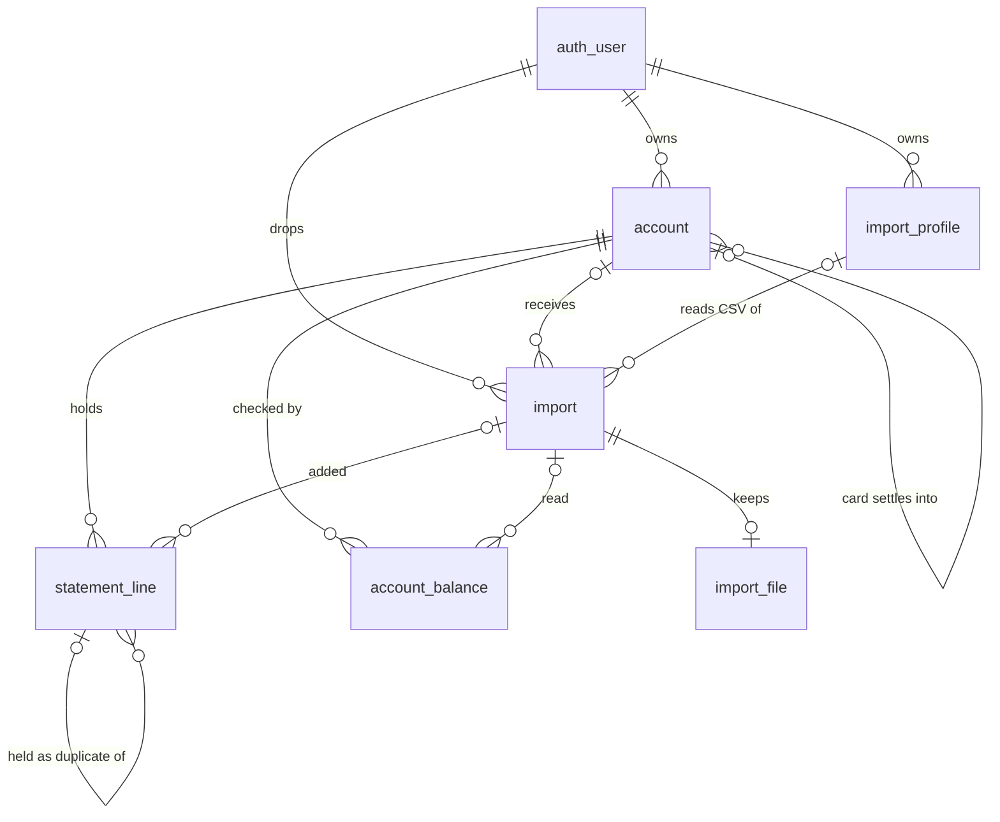
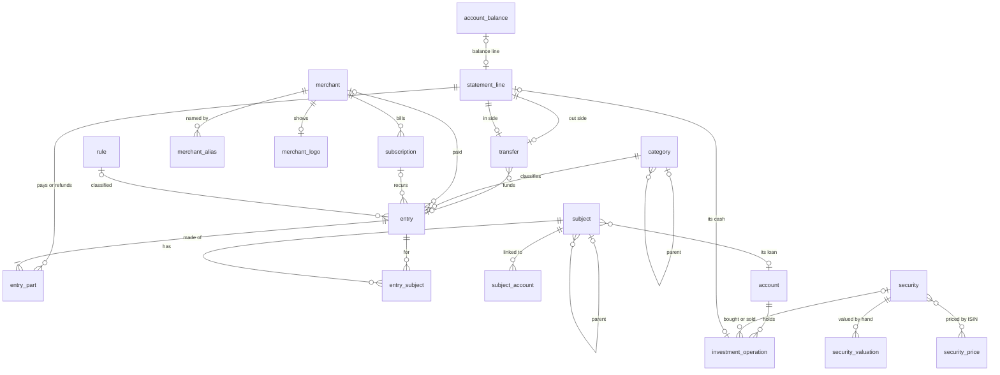

# Gousset: data model

The tables of v0.2 (users, accounts, balances, statement lines, imports, import profiles), how money, currencies, dates and ownership are stored, how each user's rows are kept apart, how an import avoids duplicates, and what the later milestones add on top. Written for issue #12; `packages/db` writes the schema from it (#13 for v0.2). The words are those of [`vision.md`](vision.md#words). Every example here is invented.

A table below gives each column its Postgres type, whether it may be null (**null**), and its default. A later milestone adds tables and nullable (or defaulted) columns; it never has to change what v0.2 wrote. Where #13's schema (PR #60) and this document differ, [Where #60 differs](#where-60-differs) says which one moves.

## Conventions

- **Postgres 18, written with Drizzle.** Tables and columns in `snake_case`, singular names (`account`, not `accounts`), as the existing `installation_settings` does. Enums are named after their table and column (`account_kind`).
- **Gousset's own ids are `uuid`, filled by Postgres 18's `uuidv7()`.** They are ordered by creation, which keeps indexes compact and makes `order by id` the order rows were made; they reveal neither how many rows other users have nor in which order they were made; and an export restored elsewhere keeps them. The user's id stays better-auth's `text`.
- **Closed sets are Postgres enums** (`pgEnum`): the database refuses an unknown value and Drizzle gives the TypeScript union. A new value is one `ALTER TYPE … ADD VALUE`, which no existing row notices.
- **Open sets are `text`**: an ISO 4217 code (`check (currency ~ '^[A-Z]{3}$')`), a shipped profile's key, an error code. A list that grows with the world, or with Gousset's releases, is not an enum.
- **Instants are `timestamptz`** (`created_at`, `updated_at`, `finished_at`), `not null default now()` for the first two. better-auth's tables keep the `timestamp` it generates.
- **`jsonb` only for a shape another package owns and decodes** with an Effect `Schema`: an import profile's definition (`packages/import`), a rule's conditions (v0.3). Anything the database must join on, constrain or refer to is a column.
- **Nothing is soft-deleted.** An account is closed, a category or a subject archived: they keep their history. What is deleted is gone, and what refers to it goes with it or loses the reference, as each foreign key says. The one row kept for its memory is a discarded line ([Statement lines](#statement-lines)), so that it does not come back.
- **An optional reference is cleared with its own column**: since foreign keys share `user_id` ([Ownership and isolation](#ownership-and-isolation)), they use `on delete set null (<column>)` (Postgres 15 and later), which never touches `user_id`. Drizzle cannot write it: those keys are in a custom migration, as #60 does.
- **A reference that refuses its row's deletion is `on delete no action deferrable initially deferred`**, written **kept** below (a category in use, a security with operations), never `restrict`. Deleting a user cascades into every table at once, in an order the foreign keys' triggers choose: a `restrict` key could fire before the rows that point to it are gone, and the user could not be deleted. A deferred key is checked at commit, once every cascade has run, and still refuses a deletion that leaves a row pointing to nothing.
- **No personal data in names, logs or telemetry**: labels, amounts, IBANs and file names live in their rows and nowhere else ([`architecture.md`](architecture.md#telemetry)).

## Money

- **An amount is a `bigint` of minor units** (cents for the euro) in the currency of its account: `amount_minor`, `opening_balance_minor`. Integers are exact, they add up in SQL without rounding, the readers of `packages/import` already give them so (`StatementLine.amountMinor`), and the made-up data (`packages/fixture`) counts that way. Drizzle reads them as JavaScript numbers (`bigint(…, { mode: "number" })`), exact up to 2⁵³ minor units, far beyond any personal amount; a `sum()` comes back from Postgres as `numeric` and is cast to `bigint` in the query.
- **Signs follow the account**: negative is money leaving the account, positive money coming in. A loan's balance is negative (what is owed), and a repayment is a positive line on it. Gousset never stores "debit" and "credit" columns: a reader that meets them turns them into a sign.
- **One currency per account** ([`vision.md`](vision.md#v1)): `account.currency`. A line has no currency of its own. Its number of minor units (2 for the euro, 0 for the yen, 3 for the Bahraini dinar) comes from ISO 4217 in code, never from a column. The currency cannot change once the account has a line (`packages/core` refuses it): every amount already stored would change meaning.
- **A payment made in another currency** keeps what the bank says it was: `original_amount_minor` and `original_currency` on the line, both or neither, for display only. Only `amount_minor`, in the account's currency, counts.
- **Quantities and unit prices of securities (v0.6) are `numeric`**: a fund's share can be 0.0347 of a unit and its price 112.4519 €. They are exact decimals, read by Drizzle as strings and computed with a decimal library; the value they give is rounded to minor units only when shown or summed with money.
- **Totals across currencies are not converted**: the accounts page totals each currency apart ([Open choices](#open-choices)).

## Dates

- **A statement's days are `date`, with no time and no time zone**, read by Drizzle as `YYYY-MM-DD` strings (`date(…, { mode: "string" })`): `booked_on` (the day the bank booked the line), `value_on` (its value date, when the file gives one). A bank's day is a day of its calendar, not an instant: stored as a timestamp in UTC, a line booked on 1 November would move to 31 October for anyone west of the bank. The readers already give days (`StatementLine.bookedOn`), a time in the file read past, never applied. Months are made of these days directly.
- **The booking date places a line in its month and in the account's balance.** The value date is kept for display and for matching transfers; nothing is computed from it.
- **The day an expense happened is the expense's own** (v0.3, `entry.happened_on`): it starts as its first payment's booking date and can be moved (a card payment of 31 October booked on 3 November). "Where the money goes" reads that date; an account's balance reads the lines'. A line stays as the bank wrote it.
- **A balance is the balance at the end of its day** (`account_balance.day`), every line booked that day included, as `packages/import`'s `Balance` is. A statement's opening balance for 1 October is stored as the balance at the end of 30 September, so that every balance compares with the same sum of lines.
- **Which day is today** is the server's, in its own time zone (`apps/web`, `lib/today.ts`): it says which month is current and what expires today. It never changes a stored date ([Open choices](#open-choices)).

## Ownership and isolation

**Every row of a user's data carries `user_id text not null`**, referencing `auth_user.id` with `on delete cascade`: deleting a user deletes their data, and an export (#22) is one query per table. Child tables carry it too (a line has its own `user_id`, not only its account's), so that every rule of isolation reads one column, with no join.

**A row can only point to a row of the same user.** Each table that is referred to has a unique key on `(user_id, id)`, and the tables that refer to it use composite foreign keys: `statement_line (user_id, account_id) → account (user_id, id)`. The database itself refuses a line of one user on another user's account, whatever the code does. Postgres checks foreign keys as the table's owner, past row-level security, so the check holds whoever runs the query. A nullable reference is checked only when set (`match simple`).

**Row-level security keeps each user's rows apart** (#13), set per transaction by the server:

1. A migration creates the role `gousset_user` (`NOLOGIN NOSUPERUSER NOBYPASSRLS`) when it does not exist yet (roles are shared by every database of the server, and end-to-end tests clone one per worker), refuses to go on if a role of that name exists but logs in, is a superuser or bypasses row-level security, and grants it `usage` on the schema and `select`, `insert`, `update` and `delete` on the users' tables.
2. Each table holding a user's rows is created with row-level security enabled **and forced** (`force row level security`, so that the policies bind the tables' owner too when it is no superuser), and one policy for every command, `<table>_own_rows_only`: `using (user_id = current_setting('gousset.user_id', true)) with check (user_id = current_setting('gousset.user_id', true))`.
3. Every server function, MCP tool and job that works for a user opens its transaction through one Effect service, `UserData` (`packages/db`), which starts with `set local role gousset_user` and `select set_config('gousset.user_id', $1, true)`. Both end with the transaction, so a pooled connection never carries a user into the next one.
4. A transaction that switched role but set no user sees an empty setting, and the policies return no row: it fails closed.

**Three roles** (#66):

| Role | Logs in | What it is |
|---|---|---|
| the tables' owner | yes | runs the migrations; the Postgres image's user (`POSTGRES_USER`, a superuser) in an installation, the server's own in development and tests |
| `gousset_app` | yes, once `migrate` lets it | the role the app logs in with: no superuser, no `bypassrls`, owns no table of `public` |
| `gousset_user` | never | what a user's transaction acts as (`set local role`) |

A migration (#66) creates `gousset_app` as it does `gousset_user` (`NOLOGIN NOSUPERUSER NOCREATEDB NOCREATEROLE NOREPLICATION NOBYPASSRLS`, when missing), and refuses to go on if a role of that name exists and is a superuser, bypasses row-level security, creates roles or replicates, or if the migrations themselves run as it. It grants `gousset_app` the role `gousset_user` **with `set` but without `inherit`**: it may act as `gousset_user` in a transaction, but holds none of its grants itself. It grants `gousset_app` `usage` on the schema and `select`, `insert`, `update` and `delete` on what is no user's data: better-auth's tables and `installation_settings`. pg-boss's schema `pgboss` (#14) belongs to `gousset_app`, which installs and migrates pg-boss's tables and makes one for each queue: the migration creates it empty (the app's pg-boss runs with `createSchema: false`, since `create schema if not exists` asks for a right `gousset_app` does not have), or, on a database where pg-boss already ran as the owner, hands every table, function and type in it over.

**`gousset_app`'s password is derived from the owner's**: an HMAC-SHA-256 of the role's name keyed with the owner's password (`packages/db/src/app-role.ts`). An installation keeps giving one URL, the owner's, to `migrate` and to the app: `migrate` applies the migrations as the owner, then lets `gousset_app` log in with the derived password (given to Postgres as a SCRAM verifier, so that the password never sits in a statement the server may log); the app turns the owner's URL into `gousset_app`'s and logs in with it, for its pages, server functions, MCP door, better-auth and pg-boss alike. It never opens a connection as the owner. A URL that already names `gousset_app` is used as it is. Nothing new is made or kept, so an existing installation moves to the new roles at its next `migrate`, and changing the owner's password changes the app's at the same `migrate`.

The role switch is what makes the policies bite: `gousset_user` is restricted by them. Outside a user's transaction the app keeps its own role for what is not a user's data: better-auth, pg-boss's own schema, installation-wide jobs (prices, v0.6). That role reaches no user's table at all, so **a user's tables are reached only through `UserData`**: a query on them elsewhere fails with `42501`. The one exception is the price job of v0.6, which reads the distinct ISINs of every user's `security` as the app's role, and nothing else of them: its migration grants `gousset_app` `select (isin)` on `security` alone, a column grant, and a policy for it, `security_isins_for_prices`, `for select to gousset_app using (true)`, beside the users' own policy. Nothing else of a user's table is ever granted to `gousset_app`.

**The administrator is a user like the others for data**: they never see another user's rows, and they cannot act as another user. better-auth's admin plugin grants its administrators the right to impersonate a user by default; `packages/auth` removes that right (#65). For a user who forgot their password, the administrator gives a new temporary one (#70): the user must replace it at the next sign-in, and every session and MCP client of theirs ends, so the administrator never learns a password the user keeps. Until it is replaced, a temporary password opens nothing but its change, on the server as on the pages: no data, no setting, no import, no MCP authorization or call. The app's server functions and routes read the session through one check, `usableSession` (`apps/web/src/lib/session.server.ts`), which refuses a held one, and a lint rule (`gousset/no-direct-session-read`) keeps any of them from reading it another way; better-auth's own routes are held by its hook, the MCP door by the grant it reads on every call. The forced change says when it was reset, and by whom: the administrator, or the server's recovery of the administrator's own (below). **There is one administrator per installation**: the administrator cannot name a second one (better-auth's `user:set-role` stays closed), since a second could ban the first and nothing could step one down; when the only administrator forgets their password, whoever runs the installation gives them a temporary one from the server, with the same effects (`recover-admin`, `docs/releases.md`, "Recovering the administrator"; #79).

**What this guards against, and what not.** Row-level security catches a query that forgets its user's filter inside `UserData`. Since #66, a query sent through the global Drizzle handle instead of the transaction's fails (`42501`, no grant), naming a user with `set_config` outside `UserData` reaches nothing more, and `reset role` (or `set session authorization default`) inside a user's transaction returns to `gousset_app`, which reaches less: a slip fails closed instead of open. Two things remain. Inside a user's transaction, SQL that is not the app's own (a value injected into a query) could still set `gousset.user_id` to another user, since the app must be able to act for any of them: every query is therefore parameterised (Drizzle's builder or `sql` with placeholders, never `sql.raw` with a value). And the app's process holds the owner's password, from which it derives its own: whoever takes over the process itself, not a query, reaches what the owner reaches. Keeping the owner's password out of the app would take a second secret for every installation to make, which an existing installation would have to make by hand.

A job that works for a user (an import, a rule applied to the past) carries the user's id in its payload (`owner`, as #14's jobs do) and opens the same transaction.

**Every table added later** carries `user_id` and its foreign key, a unique `(user_id, id)` when anything refers to it, composite foreign keys, row-level security enabled and forced with the same policy, and its grant to `gousset_user` in its migration, never to `gousset_app`. A table that is no user's data (one of better-auth's) is granted to `gousset_app` in its migration instead. #13's end-to-end test lists every table of the `public` schema that has a `user_id` (but better-auth's) and checks it has row-level security, forced, the policy and the grant; #66's lists every table, view and sequence of the database that `gousset_user` or `gousset_app` holds any privilege on, its own or a column's, and checks that `gousset_user`'s are the users' tables and `gousset_app`'s the shared ones it names, besides pg-boss's schema: a table that forgets one, or is granted where it should not be, fails them.

**Indexes and the policy.** The policy adds `user_id = …` to every query of a user's transaction. An index that serves a list therefore starts with `user_id`, or with a column that already belongs to one user (`account_id`). `current_setting` is stable within a statement, so Postgres uses such indexes. A condition whose operator is not `leakproof` (`like`, `ilike`, `pg_trgm`'s, full text's `@@`, arrays' `@>`) is only applied after the policy's, so Postgres does not use an index on it under row-level security: #21 measured it for a trigram index, never used in a user's transaction ([Statement lines](#statement-lines)). The ticket that adds such an index checks with `explain`, as `gousset_user` in a transaction set as `UserData` sets it, that it is used. No built-in function is marked `leakproof`, and no `security definer` function steps past the policy, to make one usable.

## Users

better-auth's `auth_user` is the user; its tables keep their `auth_` prefix (its `account` would collide with bank accounts). **What Gousset keeps per user is a column of `auth_user`**, declared as one of better-auth's `additionalFields` in `packages/auth` so that `pnpm auth:generate` writes it back, `input: false` so that sign-up cannot set it, and changed through Gousset's own server function. It comes with the session, so no page reads it twice. #54 does so first (PR #62):

| Column | Type | Null | Default | What |
|---|---|---|---|---|
| `single_key_shortcuts` | `boolean` | | `true` | whether the shortcuts made of one character fire (#54) |
| `color_scheme` | `text` | | `'system'` | `system`, `light` or `dark`; the server paints the first page in it, and the browser's own choice shows only before sign-in (#50) |
| `currency` (v0.3) | `text` | | `'EUR'` | ISO 4217; the default currency of a new account and the currency fixed benchmarks are written in |

`auth_user` has no row-level security: better-auth reaches it as the app's role, and `gousset_user` has no grant on it. A query in a user's transaction that needs the user's currency is given it from the session. The interface's language stays the browser's, as in v0.1: no column for it.

## Accounts

**`account`**: one per account the user follows, of every kind.

| Column | Type | Null | Default | What |
|---|---|---|---|---|
| `id` | `uuid` | | `uuidv7()` | primary key |
| `user_id` | `text` | | | the owner |
| `name` | `text` | | | as the user calls it: "Current account", "MealCard" |
| `kind` | `account_kind` | | | `current`, `savings`, `card`, `investment`, `loan`, `benefit` |
| `envelope` | `account_envelope` | null | | the tax envelope: `pea`, `life_insurance`, `livret_a`, `other` |
| `institution` | `text` | null | | the bank, broker or issuer, as text: "Northbank" |
| `currency` | `text` | | | ISO 4217, fixed once the account has a line |
| `mode` | `account_mode` | | `'lines'` | `lines` (every line imported or entered) or `balance` (a balance noted each month) |
| `opening_balance_minor` | `bigint` | | `0` | the balance before the account's first line |
| `opened_on` | `date` | null | | the day the account was opened at the bank, when known; an envelope's age counts from it |
| `closed_on` | `date` | null | | null while open; a closed account keeps its lines and leaves the totals |
| `iban` | `text` | null | | as a statement names the account (CAMT.053, MT940), upper case without spaces |
| `number` | `text` | null | | the account number an OFX or QFX file gives (`ACCTID`) |
| `settles_into_account_id` | `uuid` | null | | a deferred-debit card only: the current account it is debited from each month |
| `credit_order` | `credit_order` | | `'oldest_first'` | read for a benefit account only: in which order its credits are used, `oldest_first` (by the day credited) or `expiring_first` (by expiry date) |
| `created_at`, `updated_at` | `timestamptz` | | `now()` | |

- Keys: unique `(user_id, id)`; unique `(user_id, iban)` when set (nulls are distinct), so that an import recognises its account by it. `number` is not unique: an OFX `ACCTID` is unique only with its `BANKID`, and two banks, or two masked cards (`XXXX1234`), can give one user the same number. A file whose number matches several accounts waits for the user to choose (`import.status = waiting`).
- `settles_into_account_id`: `(user_id, settles_into_account_id) → account (user_id, id) on delete set null (settles_into_account_id)`.
- Checks: `currency ~ '^[A-Z]{3}$'`; `settles_into_account_id is null or kind = 'card'`; `iban ~ '^[A-Z]{2}[0-9]{2}[A-Z0-9]{11,30}$'`, so that the unique key compares like with like.
- No other index: a user has tens of accounts, read whole.

**Kind and envelope are two columns.** The kind says how an account behaves; the envelope says which tax rules it is under. A PEA and a securities account both hold positions; a Livret A is a savings account; a life insurance contract holds funds. So "securities account", "PEA" and "life insurance", which #15 offers as choices, are `investment` with no envelope, `pea` and `life_insurance`; a Livret A is `savings` with `livret_a`. The logic of positions is written once, and an envelope's rules apply to whichever account carries it. The envelope's figures (a contribution cap, a key date) come in v0.6, as columns of the account ([v0.6](#v06-investments)): the vision keeps them per account.

**The accounts page's groups follow the kind**, in code, not in a column: available (`current`, `card`), restricted (`benefit`), invested, shown as "Savings and investments" (`savings`, `investment`), owed (`loan`). A column would have to be kept in step with the kind for no gain.

- **A card account is a deferred-debit card**: its purchases are lines of its own, and once a month the current account pays its balance, which v0.3 pairs as a transfer (#26); a card statement that does not show that payment gets its side as a line made by the app ([v0.3](#v03-classify)). A card debited at once is no account: its payments are lines of the current account.
- **A benefit account** (meal vouchers, works council subsidies, gift cards) is money with restricted use. Its credits are positive lines, each with its expiry date (`statement_line.expires_on`). What is left on each credit, and what expires when, is computed on read in the account's `credit_order` (#16), never stored: every outgoing line (a payment, a transfer out) uses up the credits in that order, so a corrected or deleted line never leaves a stored remainder wrong. An issuer whose order is neither gets a value of its own when one is met. Expiry dates never move money by themselves: what expires unused leaves the balance when a line says so, from the issuer's statement or entered by hand. The order of use (#16), replayed over the counted lines booked up to today, by booking date then id:
  - a positive opening balance is the oldest credit, with no day and no expiry; a negative one is spent before any credit;
  - `oldest_first` uses credits by the day credited, then id; `expiring_first` by expiry date, the credits without one after every dated one, ties by the day credited;
  - a negative line uses the credits already booked; what they do not cover is taken from the next credits as they come, and shows as spent beyond the credits until then;
  - an expiry date never skips a credit: an expired credit with money left is still used in its turn, and is shown as expired and still counted, never silently as available money, until a line takes it out;
  - an account kept by its balance follows no credit: its whole balance shows as restricted.

  The account page and `accounts` `show` give the credits with money left, in that order, and what expires when (the amounts left, summed by expiry day). The expiry date and the order of use are set on the account's page (the credit, the account's settings); the MCP door reads them only.
- **A loan account** holds what is owed: its balance is negative, noted each month (balance mode) or made of its repayments. A subject with a value points to its loan (v0.5).

**`account_balance`**: a balance given for a day, by a statement or by the user.

| Column | Type | Null | Default | What |
|---|---|---|---|---|
| `id` | `uuid` | | `uuidv7()` | primary key |
| `user_id` | `text` | | | |
| `account_id` | `uuid` | | | `(user_id, account_id) → account on delete cascade` |
| `day` | `date` | | | the balance is the one at the end of this day |
| `balance_minor` | `bigint` | | | |
| `source` | `balance_source` | | | `statement` (read from a file) or `noted` (entered by the user) |
| `import_id` | `uuid` | null | | the import it was read from: `(user_id, import_id) → import on delete cascade` |

- Check: `(source = 'statement') = (import_id is not null)`.
- Indexes: `(account_id, day)`, the account page's check; `(import_id)`, for undo.
- Unique `(account_id, day) where source = 'noted'`: one noted balance a day. Balance mode makes one line per noted balance from the one before it ([Balance mode](#balance-mode)); two on a day would make that order ambiguous. Statement balances may repeat a day (two overlapping files each give theirs), and each goes with its import.

The account page's check (#15) compares the balance the app computes at the end of a day (`opening_balance_minor` plus every counted line booked up to that day) with the latest statement balance on or before today, and shows the difference; any earlier statement balance that disagrees with the app's balance at the end of its own day is shown too, so a past mismatch is never hidden. In balance mode, the noted balances are what the account is kept by.

## Statement lines

**`statement_line`**: one line of an account, as the bank wrote it. A line is never classified here: what it is (a payment of an expense, an income, a side of a transfer) is recorded by v0.3's tables, which point to it. Keeping the bank's line apart from what happened is what lets an expense be paid on two accounts, a line be split, and a classification be undone without touching the statement ([`vision.md`](vision.md#an-expense-is-not-a-bank-line)).

| Column | Type | Null | Default | What |
|---|---|---|---|---|
| `id` | `uuid` | | `uuidv7()` | primary key |
| `user_id` | `text` | | | |
| `account_id` | `uuid` | | | `(user_id, account_id) → account on delete cascade` |
| `import_id` | `uuid` | null | | the import that read it: `(user_id, import_id) → import on delete cascade` |
| `source` | `line_source` | | | `import`; `manual` (entered by the user); `balance` (made from a noted balance, v0.3); `counterpart` (the side of a transfer that the account's own file does not show, v0.3) |
| `state` | `line_state` | | `'counted'` | `counted`, `held` (a near duplicate set aside for review), `discarded` (a near duplicate the user threw away) |
| `booked_on` | `date` | | | the booking date |
| `value_on` | `date` | null | | the value date, when given |
| `amount_minor` | `bigint` | | | signed, in the account's currency |
| `original_amount_minor` | `bigint` | null | | what was paid in another currency, when the bank says so |
| `original_currency` | `text` | null | | its ISO 4217 code |
| `label` | `text` | | | the raw label, as read: "CB GREENMARKET 2110 RIVERTON"; an empty string when the file gives none |
| `memo` | `text` | null | | the rest of the bank's text, when the format has a second field (OFX's `MEMO`, QIF's `M`, CAMT's remittance information) |
| `counterparty_name` | `text` | null | | who paid or was paid, when the format names them (CAMT.053, MT940) |
| `counterparty_iban` | `text` | null | | their IBAN, when given |
| `bank_id` | `text` | null | | the bank's own reference for the line, as given, whether or not it is unique: OFX's and QFX's `FITID`, QIF's `N`, CAMT.053's account servicer reference (`Ntry/AcctSvcrRef`), MT940's references |
| `dedup_key` | `text` | null | | the key that recognises the line in a later import ([Imports and deduplication](#imports-and-deduplication)) |
| `duplicate_of_line_id` | `uuid` | null | | for a held line: the line it looks like; `(user_id, duplicate_of_line_id) → statement_line on delete set null (duplicate_of_line_id)` |
| `expires_on` | `date` | null | | a credit of a benefit account: the day it expires |
| `created_at`, `updated_at` | `timestamptz` | | `now()` | |

- Keys: unique `(user_id, id)`; unique `(account_id, dedup_key)` (nulls distinct: lines without a key never collide).
- Checks: `(source = 'import') = (import_id is not null)`; `(source = 'import') = (dedup_key is not null)`, so that every imported line takes part in deduplication; `(original_amount_minor is null) = (original_currency is null)`; `original_currency ~ '^[A-Z]{3}$'`.
- Indexes:
  - `(account_id, booked_on, id)`: an account's lines in order, and its balance at the end of a day (a sum up to that day). It also serves the near-duplicate search, which looks at a few days of one account.
  - `(import_id)` and `(duplicate_of_line_id)`: undo, and the cascades of the foreign keys.
  - `(user_id, booked_on, id)`: every line of every account in order (#21) and a month's lines (v0.4).
  - **No trigram index.** The search (#21) looks for a substring of `label || ' ' || coalesce(memo, '') || ' ' || coalesce(counterparty_name, '')` with `ilike`, in any case, `%`, `_` and the backslash taken as themselves. A `pg_trgm` GIN index on that expression is never used under row-level security, since `ilike` is not leakproof ([Indexes and the policy](#ownership-and-isolation)). Measured for #21 on 5 users × 30,000 invented lines (Postgres 18, as `gousset_user` with `gousset.user_id` set): one user's search has the same plan with the index or without it. The policy's `user_id` picks that user's 30,000 rows by index (a bitmap scan, 3,434 shared buffers), then `ilike` is read on each: 22 to 47 ms for the page of the 100 newest, and as much again for the total, whether the word is common (1,488 lines) or rare (3). As the table's owner, past the policy, the same index answers the rare word in 1.7 ms: that is what row-level security costs here. The cost grows with one user's lines, not with the installation's; the index would have cost 15 MB beside the table's 25 MB, for nothing. Searching without text, the page reads `(user_id, booked_on, id)` backwards and stops at 100 lines (0.1 ms); its total counts the user's lines (7 to 15 ms). The search reads the user's accounts apart rather than joining them: with a join Postgres reads each account's lines in turn, 9,537 buffers instead of 3,434.
- **Only `counted` lines count**: in balances, in the month, in search by default. In v0.2, the operations page's "to review" filter (#21) shows the held lines; v0.3 adds what classification leaves to review. A held line waits for the user: confirmed, it becomes `counted`; thrown away, it becomes `discarded` and stays, so that the next import of the same file does not hold it again.
- **Order**: lines are ordered by `booked_on`, then by `id`. The import saves a file's lines oldest first, keeping the file's order within a day, so that, ids being ordered by creation, that order is the statement's.
- **A line entered by hand** has `source = manual`, no import and no key: in lines mode, it is how a line the bank has not sent yet, or a benefit account without a file, is kept. When a file later brings that line, the near-duplicate rule holds the imported one for review.

## Imports and deduplication

**`import`**: one file dropped, from upload to summary. Its columns follow the job's steps (#20). Drizzle names it `statementImport`, since `import` is a keyword of TypeScript.

| Column | Type | Null | Default | What |
|---|---|---|---|---|
| `id` | `uuid` | | `uuidv7()` | primary key |
| `user_id` | `text` | | | |
| `account_id` | `uuid` | null | | the account the file belongs to; null until recognised or chosen; `(user_id, account_id) → account on delete cascade` |
| `file_name` | `text` | | | as dropped, for the user only |
| `file_sha256` | `text` | | | the file's hash, in hexadecimal: the same file dropped twice is said at once |
| `format` | `import_format` | | | `ofx`, `qfx`, `qif`, `camt053`, `mt940`, `csv` |
| `profile_id` | `uuid` | null | | the user's CSV profile used: `(user_id, profile_id) → import_profile on delete set null (profile_id)` |
| `shipped_profile` | `text` | null | | or the key of a profile shipped with Gousset |
| `status` | `import_status` | | `'queued'` | `queued`, `reading`, `waiting` (for an account or a profile), `saving`, `done`, `failed`, `undone` |
| `period_from`, `period_to` | `date` | null | | the days the file covers, as it says or from its lines |
| `lines_read`, `lines_added`, `lines_duplicate`, `lines_held` | `integer` | | `0` | the summary's counts |
| `error_code` | `text` | null | | why it failed, as a code; never the file's content |
| `job_id` | `uuid` | null | | the pg-boss job that runs it, so that the import screen follows it again after a reload (#20). No foreign key: pg-boss's tables are its own schema, and it purges old jobs |
| `created_at` | `timestamptz` | | `now()` | |
| `finished_at`, `undone_at` | `timestamptz` | null | | |

- Keys: unique `(user_id, id)`.
- Check: `profile_id is null or shipped_profile is null`.
- Indexes: `(account_id)`, an account's imports, and how far its statements go (the latest `period_to` of its `done` imports, which the monthly review shows); `(user_id, file_sha256)`, the same file dropped again. The list of imports, newest first, reads the unique `(user_id, id)` backwards.

**`import_file`**: the file's bytes, apart so that listing imports never reads them.

| Column | Type | Null | Default | What |
|---|---|---|---|---|
| `import_id` | `uuid` | | | primary key; `(user_id, import_id) → import on delete cascade` |
| `user_id` | `text` | | | |
| `content` | `bytea` | | | the file as dropped |

The job reads the file from there, so an import interrupted by a restart resumes ([`architecture.md`](architecture.md#background-jobs)); the file can be read again once a reader is fixed, and the export carries it. It is deleted when its import is undone. A file is a few hundred kilobytes; the upload refuses one over 10 MB.

**The dedup key** (#20), computed by the import (`packages/core`) from each line a reader gives:

- **When the format makes the bank's id unique within the account**: `bank:` and the id (`bank:20261021-000184`). That is OFX's and QFX's `FITID` and CAMT.053's account servicer reference, `Ntry/AcctSvcrRef`. CAMT.053's entry reference, `Ntry/NtryRef`, is never used: it is optional and often a sequence number within one statement, so line 1 of November would collide with line 1 of October and be dropped as a duplicate. QIF's `N` (a cheque number or any reference) and MT940's references (often `NONREF`) do not count: they are kept in `bank_id` and the content key is used. A line whose format counts but whose field is missing (a CAMT.053 entry without `AcctSvcrRef`) gets the content key too.
- **Otherwise**: `content:` and the SHA-256 of the booking date, the amount and the label (trimmed, inner spaces collapsed), followed by the occurrence of that triple in the file: two identical coffees on the same day are `…#1` and `…#2`, and stay two.
- The unique key `(account_id, dedup_key)` decides: the import inserts with `on conflict do nothing`, and what was not inserted is counted as a duplicate. Two imports running at once cannot add the same line twice, and an attempt run again after a crash adds nothing that the first one saved.

Reimporting an overlapping period therefore adds only what is new: a day already imported with one coffee, read again with two, adds the second. A line that was held or discarded keeps its key, so it is not held again.

**A near duplicate** is a line with no exact match but, on the same account, the same amount, a booking date a few days apart and a similar label, on a line from another import or entered by hand: the same payment read from a CSV after an OFX, say, whose labels differ. It is saved as `held`, with `duplicate_of_line_id`, and counted in `lines_held`. Two lines whose keys already tell them apart are never near duplicates of each other:

- both have a `bank:` key, and the keys differ: the bank says they are two lines;
- both have a `content:` key for the same date, amount and label, with another occurrence number: they are the second coffee of the day, which the content key counts on purpose.

So a near duplicate is always a line read in another way than the one it looks like (a `bank:` key against a `content:` one, two content keys whose labels differ) or a line entered by hand.

**Undoing an import** deletes its lines (counted, held and discarded), the balances read from it and its file, and marks it `undone`; the row stays, with its counts, in the history. It removes exactly what that import added (#20): a later import that skipped some of those lines as exact duplicates does not get them back, and importing its file again does. The undo screen says so when a later import overlaps the undone one. A line of another import that was held or discarded as a near duplicate of an undone line has lost what it duplicated: in the same transaction, undo makes it `counted` again and clears its `duplicate_of_line_id`, and the undo screen says how many lines it gives back that way. From v0.3, what points to those lines goes with them ([v0.3](#v03-classify)).

## Import profiles

**`import_profile`**: how to read one bank's or broker's CSV (#19).

| Column | Type | Null | Default | What |
|---|---|---|---|---|
| `id` | `uuid` | | `uuidv7()` | primary key |
| `user_id` | `text` | | | |
| `name` | `text` | | | "MealCard", "Northbank PEA" |
| `institution` | `text` | null | | the bank or broker it reads, as text |
| `kind` | `import_profile_kind` | | `'statement'` | `statement` (lines of an account) or `operations` (a broker's operations, v0.6) |
| `definition` | `jsonb` | | | separator, encoding, date and decimal formats, rows to skip, which column holds which field, one amount column or a debit and a credit column; with a `version` |
| `header` | `text` | null | | the file's header row, normalised, to recognise a file the profile reads |
| `created_at`, `updated_at` | `timestamptz` | | `now()` | |

- Keys: unique `(user_id, id)`. A user has a handful of profiles: no other index.
- **`definition` is decoded by an Effect `Schema` in `packages/import`**, the only place that knows its shape; the database stores it whole. Its `version` lets that schema read an older shape. The same JSON is the file a user exports to share a profile, and imports.
- **Profiles shipped with Gousset live in code** (`packages/import`), in the same shape, named by a key: a fix to one arrives with an update, with no migration of anyone's data. A user who wants to change one copies it into their own.
- **Which profile reads a CSV** (#19): with none chosen, the import takes the user's statement profile whose `header` is the file's header row as that profile reads it (the most recently saved first), then a shipped one whose header is, then detection; it records which in `import.profile_id` or `import.shipped_profile`, neither for detection or a definition given by hand. A profile chosen on resuming the import is recorded the same way.
- **No default profile on the account**: a CSV with no account in it goes, as a proposal, to the account last imported with the same profile, read from the imports.
- **Limits** (`packages/core`, refused with a code the screen and the MCP door say): at most 50 profiles per user (`TooManyProfiles`); a name or an institution of 100 characters at most, once trimmed, a `header` of 10,000 and a shared profile file of 64 KiB, checked before its JSON is parsed (`ProfileTooLong`). A header is looked for only at the file's top: within 64 KiB of text for the lines skipped, then 100 lines and 64 KiB past them; detection proposes no header past that, and a test read reads the file's first 50 lines within 200 lines and 64 KiB ([`packages/import/README.md`](../packages/import/README.md), "CSV and import profiles").

## Diagram: v0.2

Every table but `auth_user` also carries `user_id` ([Ownership and isolation](#ownership-and-isolation)).

## Where #60 differs

PR #60 (#13) writes this document's v0.2 tables, its foreign keys, its role and its policies as written here. It lacks:

1. **#60 adds** the checks `account.iban ~ '^[A-Z]{2}[0-9]{2}[A-Z0-9]{11,30}$'`, `statement_line.original_currency ~ '^[A-Z]{3}$'` and `(source = 'import') = (dedup_key is not null)` on `statement_line`, and the unique index `account_balance (account_id, day) where source = 'noted'`. It drops the unique key `account (user_id, number)`, which refuses two accounts of two banks with the same number. These are cheap before any data exists, and each guards a rule that later code relies on.
2. **Left to the ticket that needs it**, each an addition that changes nothing #60 wrote:
   - `import.job_id`: added by #20, which writes the import's job;
   - `statement_line`'s `(user_id, booked_on, id)` index: #21, which searches every line. #21 adds no trigram index, which row-level security keeps from being used ([Statement lines](#statement-lines)).

## Migrations

From v0.2 on, installations hold real households' data, and every update runs the migrations on it (`migrate`, [`releases.md`](releases.md#installing)). An update must never lose, duplicate or silently change a row, and an installation updated from the last release must be what a fresh one is (#102). The rules:

- **Forward only.** A migration is never edited once it is on `dev` or a `next/x.y` branch, and none is ever undone: going back is restoring the backup made before the update ([`releases.md`](releases.md#going-back)). A mistake is mended by the next migration.
- **A destructive change takes two releases.** Dropping or renaming a table or a column, narrowing a type (`text` to `varchar(n)`, `bigint` to `integer`), or a `not null` on a column that has rows: the first release adds the new column or table and copies the data into it, and the code reads the new one; the release after removes the old one. An installation that skips a release still goes through both, in order. Adding a table, a nullable or defaulted column, an index, or a value to an enum is one release.
- **Every migration runs inside a transaction**, and is safe to run on a database that already has it. Drizzle's migrator applies every pending migration in one transaction and records each by name in `drizzle.__drizzle_migrations`, so a migration that fails leaves the database as it was. Nothing in a migration may need to run outside one (`create index concurrently`, `alter type … add value` used in the same migration); what Drizzle does not write (roles, grants, policies, a `do` block) is written so that it does nothing the second time (`if not exists`, `when duplicate_object`), as `user_data_isolation` and `app_role` are.
- **A migration's timestamp follows every migration of its target branch** (`dev` or `next/x.y`) when it lands. The migrator applies, in the order of their names, the migrations a database has not recorded: one that lands with an older timestamp than a migration already released runs last on an updated installation and in its place on a fresh one, and the two schemas may differ. After merging the target branch into one's own, a migration made before the merge that is no longer the last is generated again (`drizzle-kit generate` after removing it), never renamed by hand.

The `upgrade` workflow checks every push to `dev` and `next/**`, and every pull request that touches what an update runs through (the list is in [`releases.md`](releases.md#every-release-is-an-upgrade): `packages/db` among it), against these rules ([`releases.md`](releases.md#every-release-is-an-upgrade)): the last release, filled with invented data, updated to the commit, with every row of every table compared before and after, and the schema compared with a fresh installation's.

## What later milestones add

Each later table carries `user_id`, composite foreign keys and the same policy ([Ownership and isolation](#ownership-and-isolation)), and `created_at` and `updated_at` when its rows are edited. None changes a column of v0.2: they add tables, and the nullable or defaulted columns named here. Columns are given as `name type` (**null** when they may be).

### v0.3: Classify

**What a line is, outside the line.** A line says what the bank wrote; what happened is an **entry**: an expense or an income, with one category. Lines are attached to entries in parts, so one model covers an expense paid on two accounts, a refund and a split line.

**`category`**: `id`, `user_id`, `parent_id uuid` null, `kind entry_kind` (`expense`, `income`: the entry's own enum, since a foreign key compares the kinds), `name text`, `icon text` null (a key of the icons shipped with `packages/ui`), `position integer` default `0`, `archived_at timestamptz` null, `benchmark_mode benchmark_mode` default `automatic` (`automatic`, `fixed`, `none`), `benchmark_minor bigint` null (a fixed benchmark, in the user's currency), `is_fallback boolean` default `false` (#23), `created_at`, `updated_at`.

- Unique `(user_id, id)` and `(user_id, id, kind)`; unique `(user_id, kind, parent_id, name) nulls not distinct`, so two top-level categories of a kind cannot share a name either, while an expense "Other" and an income "Other" can both exist. `packages/core` compares names in any case, and refuses a name empty or over 100 characters once trimmed, or holding `>` ("Housing > Rent" is how a child is named where a name alone is not enough); at most 300 categories per user, archived ones included.
- **The fallback** (#23): unique `(user_id, kind) where is_fallback`, one per kind, "Other" in the default set. It is where an entry goes until it is classified (the import, the backfill below). It can be renamed, given a benchmark, and moved, under a parent of its kind too (the rule of two levels still applies), but never archived, merged away, nor archived with a parent: `packages/core` refuses it. Something may be merged into it.
- `(user_id, parent_id, kind) → category (user_id, id, kind)`, kept: a category's children share its kind, and a parent with children is not deleted. A third level is refused by `packages/core` (#23), which reads the parent's own `parent_id`; the database does not see depth.
- Check: `(benchmark_mode = 'fixed') = (benchmark_minor is not null)`.
- Categories are archived, never deleted while an entry uses them; merging moves the entries, rules and merchants' default categories, then deletes the merged one. A merged parent's children go under the target, which must then be top-level; one whose name a child of the target has already is merged into that child. Archiving a parent archives its children; an archived category keeps its entries and can no longer be chosen (as a parent, a merge's target, a line's category); restoring a parent restores the children archived with it. Siblings are ordered by `(position, id)`, `position` not unique, so a move writes the moved row only.
- The default set (`packages/core`, `default-categories.ts`) is copied into a user's rows when the user is created (better-auth's `user.create.after` hook, `packages/auth`), in the language the request's browser prefers, French or English: at sign-up the user's own, for a user the administrator creates the administrator's. From then on the names are theirs. v0.3's migration (`*_categories_isolation`) gives each existing user the set in English, and a unit test keeps its list equal to the code's.

**`merchant`**: `id`, `user_id`, `name text`, `default_category_id uuid` null (`on delete set null (default_category_id)`), `is_intermediary boolean` default `false` (#30), `logo_key text` null (a logo shipped with Gousset). Unique `(user_id, id)` and `(user_id, name)`: merchants are each user's own, and a name names one of them, as MCP results name merchants. **`merchant_logo`**: `merchant_id` (primary key, `on delete cascade`), `user_id`, `media_type text`, `content bytea`, a picture the user uploaded, apart as `import_file` is. **`merchant_alias`**: `id`, `user_id`, `merchant_id` (`on delete cascade`), `alias text`, `created_at`, a cleaned label that names the merchant (#24); unique `(user_id, alias)`: one cleaned label names one merchant; index `(merchant_id)`. Merging two merchants moves their aliases, entries, rules and subscriptions, then deletes the merged one; the merchant kept keeps its default category, and takes the merged one's when it has none.

- **#24 lands in steps.** Its first pull request writes `merchant` with `id`, `user_id`, `name`, `created_at` and `updated_at`, and `merchant_alias`. `default_category_id` comes with the categories (#23, which landed second: `*_merchant_default_category` adds the column and its index, `*_merchant_default_category_key` its key), `is_intermediary` with #30 (`*_merchant_intermediary`), `logo_key` and `merchant_logo` with #24's second pull request (the logos).
- **A merchant's default category classifies its entries** (#23): an entry still classified by default (`classified_by = default`), of the category's kind, goes in it and stays classified by default, a guess the review still lists and a rule overwrites; an entry the user classified is never touched, nor one split across lines of several merchants. It applies at recognition (the end of each import, and the boot job), when an entry is made for a line of a known merchant (an import's chunk, an undo, an unpairing), when the merchants change (a merge, a cleaned label moved) and when a default is set, changed or cleared: the merchant's entries still classified by default then go to the new category, or back to their kind's fallback. An archived default classifies nothing new and keeps what it has.
- **A merchant's default category** (`default_category_id`): `(user_id, default_category_id) → category (user_id, id)`, `on delete set null (default_category_id)`; index `(default_category_id)`, which a merge of categories and the key's clearing read. It is of either kind: recognition gives a merchant to incoming lines as well (an employer, a shop that refunds), so an income category may be one's default. The user chooses it among the categories in use, of both kinds; an archived category is refused (`packages/core`). Archiving its category keeps it, shown as archived until the user chooses another; merging its category moves it to the target, as the entries go.
- **A line's merchant is read, not stored**: its label (or its counterparty's name, when the format gives one) is cleaned in code (`packages/core/src/merchants/labels.ts`, whose README says the rules), and the alias equal to it names the merchant. The line stays as the bank wrote it. An entry is the merchant's of its line, read the same way: `entry.merchant_id` waits for the rules (#25), which store it.
- **Payment intermediaries** (#30): a merchant with `is_intermediary` (PayPal, Lydia, SumUp…) stands between the buyer and who was paid, so its cleaned label names no one the user paid. Recognition marks a merchant it makes from a cleaned label equal, letters and digits only, to one of the intermediaries Gousset knows (`packages/core/src/merchants/intermediaries.ts`; never a prefix: `LYDIA MARTIN` is a person); the user marks or unmarks any merchant. Nothing is backfilled: no release had merchants before. A line's intermediary is read from its label as its merchant is (the alias's merchant, when marked), never stored, so a mark, a merge or a moved alias changes it at once. Who was paid is its one entry's `merchant_id`, which the user sets by hand on a counted line of one entry made of the whole line (`classified_by = user`, no rule; an entry still classified by default goes in that merchant's default category) and a rule then sets on the next such lines (`label contains` the intermediary's name through who was paid, `PAYPAL *PIXELPLAY`, never the intermediary alone). An intermediary is never who was paid. A merge keeps the flag when either merchant had it.
- **Recognition** adds the aliases, and the merchants they need, for every line (counted or held) whose cleaned label names none yet: at the end of every import, in the transaction that marks it done, and once at every boot for every user, in a job (`recognise-merchants`), so that the lines kept before v0.3 get theirs after the update. A cleaned label that matches a known one (an alias, or a merchant's own name, compared letters and digits only, a word prefix counting) joins that merchant; otherwise it makes one. A known alias is never moved by it: what the user renamed, split (an alias moved to another merchant) or merged stays. Undoing an import keeps the merchants and aliases it made: they are the user's, and name the same shop in the next file.

**`rule`**: `id`, `user_id`, `position integer`, `enabled boolean` default `true`, `conditions jsonb` (qnot's query or our own evaluator's, in the same JSON shape, decoded by a `Schema` in `packages/core`; #25), what it sets as columns: `set_kind entry_kind` null (`expense`, `income`) or `set_transfer boolean` default `false`, `set_merchant_id uuid` null, `set_category_id uuid` null, and from v0.5 `attach_subject_id uuid` null, each `on delete set null (<column>)`; `applied_count integer` default `0`, `created_from rule_origin` (`correction`, `user`). Ordered by `(position, id)`.

- **Conditions are `jsonb`, actions are columns.** A condition is a query of open shape that another library defines; an action is one of four things, and each names a row that can be merged or deleted: as a foreign key, a merge moves it with one `update` and a deletion clears it, where an id inside JSON would point to nothing.
- **#25 writes** `rule` with `set_merchant_id` and `set_category_id` (each `(user_id, <column>) → merchant`/`category (user_id, id)`, `on delete set null (<column>)`, indexed for the merges), without `set_kind` and `set_transfer`: the kind follows the category, and pairing a line as a transfer stays the import's and the user's (#26, #131) until a rule needs it. `*_rules` adds the table and `entry`'s `merchant_id` and `rule_id` (both indexed), `*_rules_isolation` the keys, the forced row-level security and the grant. Unique `(user_id, id)`; at most 200 rules per user.
- **The conditions** (`packages/core/src/rules/conditions.ts`) are one qnot group whose conditions must all hold, at most 10, on `label` (any case: `contains`, `startsWith`, `endsWith`, `eq`, `notContains`), `account` (`eq`, `neq`, one of the user's), `amount` (without its sign, in the account's currency units; `eq`, `between`, `gte`, `lte`, `gt`, `lt`, `neq`), `direction` (`out`, `in`), `day` of the month and `date` of booking. They are evaluated in JavaScript on each new line at import, and as parameterized SQL (qnot's) over the lines already there.
- **What a rule does** to an entry made of one whole line (a split or linked line is the user's): its category when it is of the entry's kind and not archived; its merchant; a merchant alone brings that merchant's default category of the entry's kind. The entry is then `classified_by = rule`, `rule_id` the rule's. Rules are tried in `(position, id)` order, the first that applies wins. At import (in the transaction that ends it, after the merchants' defaults) only entries still `classified_by = default` are tried; applying a rule to the past (a job) changes the matching entries classified by default or by a rule, and those classified by the user only when asked. `applied_count` adds the lines each run changed. Merging merchants or categories moves the rules that set them, and the entries' `merchant_id`.

**`entry`**: `id`, `user_id`, `kind entry_kind`, `happened_on date`, `category_id uuid`, `merchant_id uuid` null (`on delete set null (merchant_id)`), `note text` null, `classified_by classified_by` (`default`, `rule`, `user`), `rule_id uuid` null (`on delete set null (rule_id)`), and from v0.4 `subscription_id uuid` null; `created_at`, `updated_at`. #23 writes the table without `merchant_id`, `rule_id` and `subscription_id`: #25 (`merchant_id` and `rule_id`) and v0.4 each add theirs as a nullable column, with its key. `entry.merchant_id` is the merchant a rule set, or the user behind an intermediary (#30); an entry without one is still its line's merchant's, read from the label (#24). An entry has no intermediary column: its line's label names the intermediary (#30, above).

- `(user_id, category_id, kind) → category (user_id, id, kind)`, kept: an expense has an expense category, and every entry has exactly one (#23).
- **Every counted line with an amount has exactly one entry** (#23) until it is split or linked (#27): an expense when its amount is negative, an income when positive, `happened_on` its booking date, in its kind's fallback category, `classified_by = default`, with one `payment` part of the whole line. `packages/core` writes it in the transaction that writes or counts the line: the import, with each chunk of lines it inserts (only the rows actually inserted, so an attempt run again adds nothing), and undo, for the lines it counts again. A held or discarded line has none, nor a line of no amount: there is nothing to classify. Nor has a side of a transfer (#26), which is the transfer: a line has an entry or is a transfer's side, never both. Whatever pairs lines (the import's pairing, the one on demand, a card's debit, the user's) deletes their parts, then an entry left with none, in the transaction that pairs them; whatever unpairs a line (the user, undo deleting its other side) gives it back its default entry. The import gives a line its entry as it saves it and takes it back when it pairs the line, in the transaction that ends it: no commit leaves a line with both, or with neither. v0.3's migration gives one to every such line already there, user by user (`set_config('gousset.user_id', …)` for each, since `statement_line` already forces row-level security on its owner), and adds nothing when run again.
- `classified_by = 'default'` says nothing was decided yet: a rule overwrites it, and the lines to review list it (the operations page's filter, `lines` `to_review`); `rule` was a rule's; `user` the user's. Choosing a line's category (`packages/core`, `classifyLine`), or its kind's fallback, sets its one entry's, as `user`.
- Index `(user_id, happened_on)`: the month, by the day the expense happened. Indexes on `category_id` and `merchant_id`: the breakdowns and the merges.
- `classified_by = 'user'` is what keeps a manual correction from being overwritten by a rule without asking (#25).
- Its net cost is computed on read: its payments less its refunds.

**`entry_part`**: `id`, `user_id`, `entry_id uuid` (`on delete cascade`), `line_id uuid` (`→ statement_line on delete cascade`), `role entry_part_role` (`payment`, `refund`), `amount_minor bigint` (positive: `check (amount_minor > 0)`); no timestamps, since a part is written again rather than edited. A `payment` moves money the entry's way (out for an expense, in for an income), a `refund` back. Unique `(entry_id, line_id, role)`; index `(line_id)`. A line's parts add up to its amount once it is classified, which `packages/core` keeps in the transaction that writes them: a constraint across rows would need a trigger, for a rule that one function writes.

- an expense paid 25 + 50 on two accounts: one entry, two `payment` parts (#27);
- a refund of 20: a `refund` part on the incoming line; the net cost is 55;
- a line split across two categories: two entries, each with a part of the line;
- a meal-voucher top-up (#28): one entry, a payment on the benefit account and one on the bank card.

An entry's parts are all in one currency, refused otherwise by `packages/core`, until rates are decided.

**`transfer`**: `id`, `user_id`, `out_line_id uuid`, `in_line_id uuid` (each `→ statement_line on delete cascade`, each unique), `paired_by paired_by` (`import`, `rule`, `user`), `funds_entry_id uuid` null (`on delete set null (funds_entry_id)`), the expense a works council refund funds (#29; the expense keeps its cost). Check `out_line_id <> in_line_id`. A line is the side of one transfer at most: the two unique keys stop it being twice the same side, and `packages/core`, which writes every pairing, refuses a line that is already the other side of a transfer (two keys over two columns cannot say it).

- The import pairs two lines of opposite amounts, a few days apart, on two of the user's accounts in the same currency, when there is one candidate; with several, it writes nothing and the line waits in the review, its candidates found again when shown (#26). The user may pair two lines by hand, across currencies too.
- **A `savings` account dates by the fortnight** (#131): regulated savings count money in and out from the 1st or the 16th, so a transfer may show on the savings account at the next fortnight's start. When one side is on a `savings` account, two lines are candidates when the later is booked (or valued) no more than 4 days after the start of the fortnight that follows the earlier: up to 20 days apart; between other kinds the window stays 4 days. It is the kind's, not a setting of the account: a savings account that dates by the day only sees a wider window, its lines being transfers in almost every case, and two candidates in that window still go to the review, never paired automatically. A setting can come if a savings account is ever paired wrongly. The automatic pairing weighs a line's candidates within 4 days first, as before: only a line with none that near weighs the fortnight's, so that a weekly transfer to a savings account still pairs each line with its own day's, and a line is paired with a farther candidate only when that candidate has no nearer one and the line is its only one. A line's detail offers every candidate in the window. The import reads the lines 54 days around its own (twice the longest window, and 14 days for value dates), so that a candidate's other candidates are seen and an ambiguous line is never paired by itself.
- A deferred card's monthly debit is a transfer from the current account to the card account (#26); when the card's statement does not show it, the app makes that side (`source = counterpart`). A later file that brings the real line replaces it: the transfer moves to the imported line, and the counterpart is deleted.
- The user's "not a transfer" holds: unpairing two lines sets `statement_line.transfer_refused` on both, and the automatic pairing (the import's, the one on demand, a card's debit) leaves such a line alone; a line's detail still offers its candidates, and pairing it by hand clears the mark (#26). Unpairing deletes a side the app made, and puts both lines back `to_review`; pairing by hand sets both `done`.
- #26 ships `transfer` without `funds_entry_id`, which #29 adds with `entry` there to point to.
- A transfer to a `savings` or `investment` account is what the month calls "set aside". A side whose other account is not followed is no transfer: it stays an expense or an income.

**On `statement_line`**: `review_state review_state` default `to_review` (`to_review`, `done`): what the monthly review lists, set to `done` by the import when a rule classified the line surely, or by the user. Every v0.2 line starts `to_review`, which is what it is. `transfer_refused boolean` default `false`: the user said the line is no transfer (#26), so that nothing pairs it again without them. A line is classified when its parts add up to it, when it is the side of a transfer, or (v0.6) when it is the cash of an investment operation; that is read, not stored. And `balance_id uuid` null, unique, `(user_id, balance_id) → account_balance (user_id, id) on delete cascade`, for a line of `source = balance`: it goes with its noted balance. v0.3 adds `account_balance`'s unique `(user_id, id)` for it.

**On `account`**: `balance_category_id uuid` null (`on delete set null (balance_category_id)`), the category a balance-mode account's movement goes to (#31).

#### Balance mode

An account kept by its balance (#31) has no lines from a file, but the month still needs its movement. Every noted balance makes **one line** (`source = balance`, its `balance_id`): the noted balance less the previous one, less the other lines booked in between. Those are the transfers known, whose other side is on a followed account and which #26 gives the balance-mode account as a line (`source = counterpart`), and the lines entered by hand, such as a benefit credit with its expiry date. Going from 120 to 80 with a transfer of 50 in gives a line of −90, classified as one expense in the account's category. A noted balance changed or deleted remakes the line after it. Everything after that (balances, the month, the review) reads lines, whatever the account's mode.

How #31 writes it:

- **One function remakes the movements** (`packages/core`, `balance-lines.ts`), in the transaction of every write that may change one: a balance noted, the account's settings (its opening balance, mode and category), a line paired with the account (the app makes its side) or unpaired, an import's end and its undo. It takes the user's turn among the changes of the categories first (`category-turn.ts`), so that two never run at once. A movement whose amount did not change keeps its line and its entry, so a classification by hand stays; one that changed gets a new entry. A movement of zero is a line of no amount, with no entry. An account kept by its lines has none. A job (`remake-balance-lines`) runs it once at every boot for every user, for the balances noted before v0.3: an update never adds rows to an existing table in its migration.
- **Its entry is classified by default**, in the account's category when that category is of the movement's kind and not archived, else in the kind's fallback; changing the account's category moves the movements still classified by default, as a merchant's default does. A movement in its account's own category is no line to review: the user chose that category.
- **A line is paired with an account kept by its balance** by the user (`Transfers.pairWithAccount`): the app makes that account's side (`source = counterpart`), the same day, of the opposite amount, in the line's currency only.
- **An account's balance stays the latest balance noted up to the day**, as in v0.2: a transfer booked after the last noted balance shows in the account's lines, and in its balance once the next one is noted.

**Undoing an import from v0.3**: the parts and transfers of the undone lines are deleted with them (`on delete cascade`), an entry left with no part is deleted in the same transaction, and the other side of a deleted transfer goes back to `to_review`, with its default entry. The undo screen says how many classified lines it removes.

### v0.4: Monthly review

- **Benchmarks** are the category's columns above; an automatic one (the average of the six previous months) is computed on read.
- **`subscription`** (#34): `id`, `user_id`, `merchant_id uuid` (`on delete cascade`), `cadence cadence` (`weekly`, `monthly`, `yearly`), `expected_amount_minor bigint`, `currency text`, `last_seen_on date`, `state subscription_state` (`detected`, `confirmed`, `dismissed`, `stopped`). Index `(merchant_id)`. Detection runs at import; the user's answer is kept, so a dismissed one is not proposed again. An entry names its subscription (`entry.subscription_id`, `on delete set null (subscription_id)`), so a price rise is read from its entries and the calendar draws the next payments from `last_seen_on` and `cadence`.
- The review's proposals are the entries the rules wrote, still `to_review` (#35): accepting one sets the line `done`; correcting it writes the entry as `classified_by = user` and proposes a rule.
- The month's figures, what drifts, what expires and how far each account's statements go are computed on read ([`architecture.md`](architecture.md#background-jobs)): no table. A benefit credit appears on the calendar on its `expires_on`.

### v0.5: Subjects

- **`subject`**: `id`, `user_id`, `parent_id uuid` null (kept: a subject with children is not deleted), `name text`, `archived_at timestamptz` null; with a value, `estimated_value_minor bigint` null and `value_currency text` null (both or neither), `loan_account_id uuid` null (a `loan` account, `on delete set null (loan_account_id)`); with dates, `starts_on date` null and `ends_on date` null (`check (ends_on >= starts_on)`). Unique `(user_id, id)` and `(user_id, parent_id, name) nulls not distinct`. Any depth; a cycle is refused by `packages/core`, which walks the new parent's ancestors in the transaction that moves it.
- **`entry_subject`**: `entry_id`, `subject_id`, `user_id`; primary key `(entry_id, subject_id)`, index `(subject_id)`, both `on delete cascade`. An entry's subjects, zero or more. Counted in full in each, and once in a parent ([`vision.md`](vision.md#subjects)): a rule of the queries, not of the tables.
- **`subject_account`**: `subject_id`, `account_id`, `user_id`; primary key `(subject_id, account_id)`, both `on delete cascade`. The accounts linked to a subject (the van's fuel card, say).
- Splitting by subject is splitting a line into entries, as for categories. A rule attaches a subject through `rule.attach_subject_id`.

### v0.6: Investments

- **`security`**: `id`, `user_id`, `isin text` null (null for a fund without one, such as a life insurance euro fund; `check (isin ~ '^[A-Z]{2}[A-Z0-9]{9}[0-9]$')`), `name text`, `currency text`. Unique `(user_id, id)` and `(user_id, isin)`: one row per user and ISIN, since what a user holds is theirs.
- **`security_price`**: `isin text`, `day date`, `price numeric`, `currency text`, `source text`, `fetched_at timestamptz`; primary key `(isin, day)`. A day's price of an ISIN, fetched by the daily job and shared by the installation, since a price says nothing about anyone. It has no `user_id`. Its row-level security gives `gousset_user` `select` only, with the policy `using (isin in (select isin from security))`, itself filtered by `security`'s policy, so nobody learns what another holds; only the app's own role, in the price job, writes it. With `installation_settings`, it is the only table without an owner. #13's test finds the users' tables by their `user_id`, so v0.6 extends it to every table granted to `gousset_user`: `security_price` must have row-level security and its policy, or any user could list every ISIN held on the installation.
- **`security_valuation`**: `id`, `user_id`, `security_id uuid` (`on delete cascade`), `day date`, `value_minor bigint`; unique `(security_id, day)`. A holding without an ISIN, valued by hand.
- **`investment_operation`**: `id`, `user_id`, `account_id uuid` (`on delete cascade`), `import_id uuid` null (`on delete cascade`, which only an account's or a user's deletion reaches, since an undone import's row stays: undo deletes its operations itself, as it does its lines), `kind operation_kind` (`contribution`, `purchase`, `sale`, `dividend`, `fee`, `withdrawal`), `happened_on date`, `security_id uuid` null (kept; set for `purchase`, `sale` and `dividend`), `quantity numeric` null and `unit_price numeric` null (`purchase`, `sale`), `amount_minor bigint` (signed, on the account's cash), `fees_minor bigint` default `0`, `line_id uuid` null and unique (`on delete set null (line_id)`), the account's cash line, so that a purchase is never counted as spending, and `dedup_key text` null with unique `(account_id, dedup_key)`. Brokers' exports come in through import profiles of the `operations` kind, with the same dedup keys. Index `(account_id, happened_on)`. Holdings are computed on read, by security.
- **Net contributions** are the transfers into the account (v0.3's `transfer`) less those out, plus the `contribution` operations of an account whose money goes in directly (a life insurance contract paid from the bank by its insurer).
- **On `account`**: `contribution_cap_minor bigint` null and `envelope_key_date date` null; the opening date is `opened_on`. The rules shipped for the PEA, life insurance and the Livret A live in code and fill them when the envelope is chosen; for `other`, the user fills them.
- **On `installation_settings`**: `prices_enabled boolean` default `true` and `price_source text` null, the source the administrator chose.

### Diagram: what later milestones add

## Open choices

Decided here, with what was set aside; each can be revisited by its milestone.

- **Ownership by row-level security and composite keys**, rather than a `where user_id = …` in every query, or a schema or database per user. A forgotten filter leaks; a schema per user multiplies migrations and breaks one export query per table. Composite keys add a column to each foreign key, for a guarantee the database keeps itself.
- **One `statement_line` table, never classified**, rather than a `transaction` row carrying its kind and category. A kind on the line cannot say "25 here and 50 there make one expense of 75" nor split a line; entries and parts can, and an undo or a reclassification never touches what the bank wrote.
- **`bigint` minor units**, rather than `numeric(…, 2)`: the number of decimals depends on the currency, and integers are what the readers and the made-up data already give.
- **`date` for a statement's days**, rather than `timestamptz`: a bank's day has no time zone.
- **A per-user time zone is left out.** Today is the server's day, as v0.1 has it; an installation whose users live in different zones would add `auth_user.time_zone text` null (null: the server's), which nothing of this model has to change for.
- **The user's settings live on `auth_user`**, as better-auth's additional fields (#54 does so), rather than in a table of Gousset's: they come with the session, and better-auth's generator keeps them.
- **Account names are not unique**: two "Livret A" at two banks are both fine. MCP results give the name with the institution. Merchants and categories, which a rule or a merge names, are unique by name.
- **Benefit credits' remainders and every total are computed on read**, never stored: a corrected line never leaves a stored figure wrong, and one person's volumes need no cache.
- **Exchange rates are not decided.** Totals across accounts of different currencies need a rate. Fetching rates is a call out of the server that the vision does not list; entering them by hand is tedious. Until decided, totals are given per currency, and an entry's parts are in one currency.
- **A bank whose ids change between downloads.** Some banks give a new `FITID` to the same line in each file; with the bank's id first, such a file would add every line again. If one is met, the import falls back to the content key for that institution.
- **Accounts shared between two users** come later ([`vision.md`](vision.md#later)): a user's rows are theirs alone, and sharing will need its own policy.
